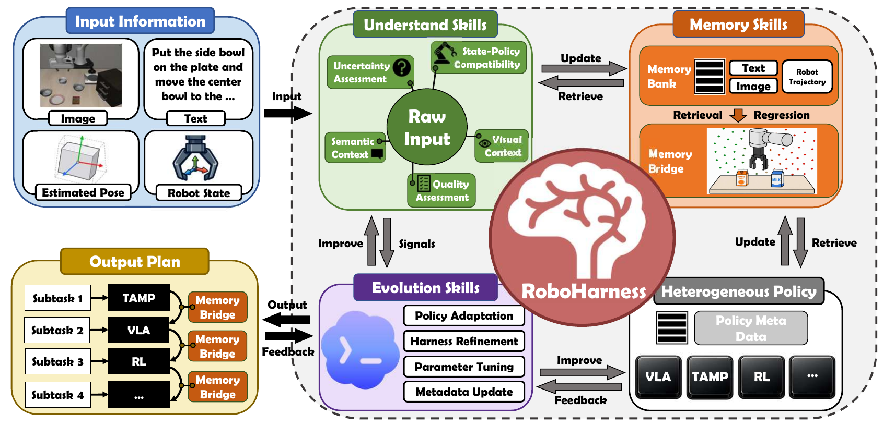
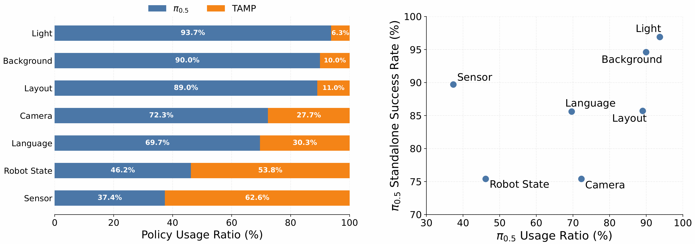
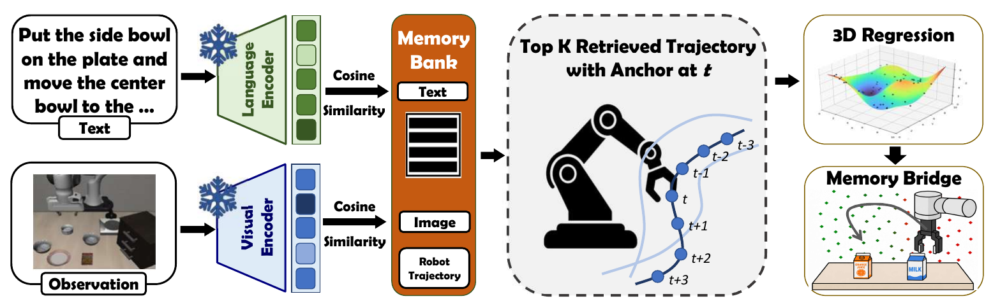
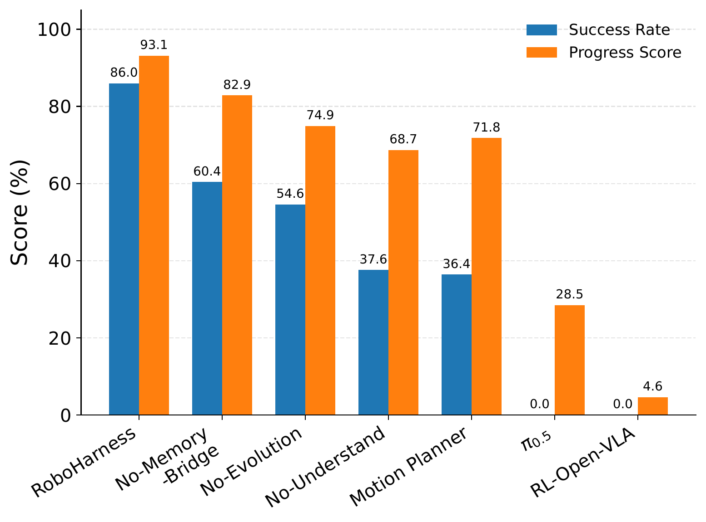
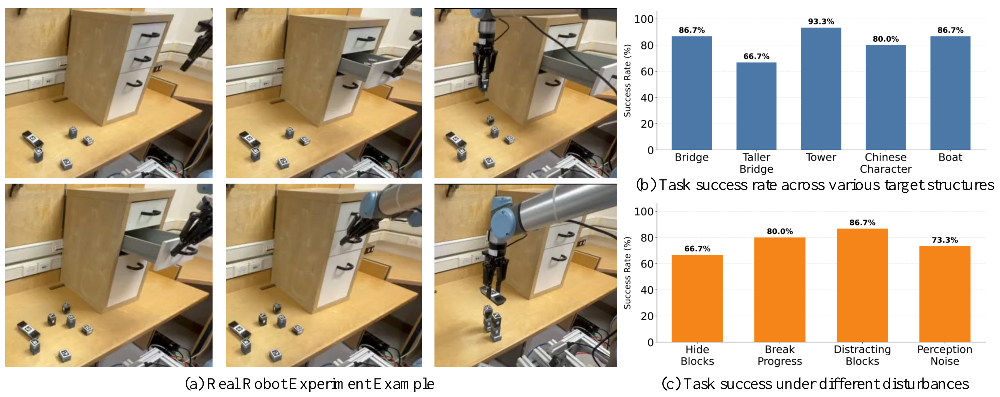

# RoboHarness

RoboHarness: Memory-Driven Orchestration of Heterogeneous Robot Policies for Long-Horizon Planning

A coding agent harness for long-horizon robot planning and heterogeneous policy orchestration.

[Paper](https://arxiv.org/abs/2607.18060v3) · [Project website](https://www.robo-harness.com/) · [Citation](#citation)

## Research summary

RoboHarness is a coding agent harness for long-horizon robot planning and control through heterogeneous policy orchestration. A coding agent serves as the high-level planner and policy router, while independently developed robot policies execute the selected subtasks. Understanding, memory, and evolution skills support capability-aware task decomposition and policy selection. Memory Bridge uses execution memory to address distribution mismatches during policy handoffs, enabling heterogeneous policies to work together without joint retraining.

**Authors:** Jinbang Huang¹, Zhiyuan Li²,\*, Yuanzhao Hu³,\*, Ran Qi²,\*, Yixin Xiao¹, Mark Coates⁴, Tongtong Cao⁵, Zhanguang Zhang¹, Yingxue Zhang¹

¹Huawei Noah's Ark Lab · ²University of British Columbia · ³University of Toronto · ⁴McGill University · ⁵Department of Foundation Model, 2012 Labs

\*Work done during the internship at Huawei Noah's Ark Lab

This repository currently contains the project website, its page generator, and demonstration media. It does not currently include the robot-policy implementation, training, or evaluation code.

## See It In Action

Long-horizon rollouts of RoboHarness orchestrating heterogeneous policies — decomposing an instruction, routing each subtask to the right policy, and bridging every handoff.

- **Task 1.** Open the top drawer of the cabinet and put the middle bowl in it, then put the remaining bowls on the plate.
- **Task 2.** Put the butter and chocolate pudding in the pan, then turn on the stove, finally put the pan on the stove.
- **Task 3.** Stack the bowl on the cabinet on the ramekin, put the bowl on the stove on the plate, and put the cookies on the cabinet.
- **Task 4.** Put both bowls on the microwave and close the microwave.
- **Task 5.** Put the bowl in the top drawer, close the top drawer, and put the ketchup on the plate.
- **Task 6.** Put the ramekin on the stove, pick the akita black bowl from the opened top drawer of the wooden cabinet and place it on the plate, and put the cookies in the already-open top drawer.
- **Task 7.** Put the bowl on the stove, turn on the stove, put the cream cheese on the bowl, and put the wine on the rack.
- **Task 8.** Pick up the cookies, alphabet soup, cream cheese, and butter and put them in the tray.
- **Task 9.** Put the side bowl on the cabinet, put the bowl in the center on the plate, and put the ramekin on the stove.

## Motivation

### Moving Beyond the Universal Embodied Model
**Embodied AI Is Shifting Toward Heterogeneous Policy Orchestration**

As VLA, WAM, RL, TAMP, MPC… each model encounters distinct capability boundaries, the key to completing complex robotic tasks may no longer lie in the strength of any single model, but in whether the system can perform capability-aware task decomposition and route each subtask to the right policy at the right time.

> There is no universally best model — only the policy best suited to the situation.

Embodied AI is in the midst of a race to expand model capabilities. VLA models continue to scale up parameters and training data; WAMs seek to improve decision-making by predicting future outcomes; RL strengthens specific behaviors through post-training; and TAMP relies on logical and geometric constraints for precise planning… Each approach is trying to answer the same question: how can we make robots more intelligent and more general?

Yet in the real world, one fact is becoming increasingly clear: no single policy excels simultaneously at semantic understanding, closed-loop control, geometric precision, long-horizon reasoning, and out-of-distribution robustness. A "universal embodied model" remains an inspiring aspiration rather than an engineering reality that can be deployed today.

### The Universal Embodied Model Is Compelling — but How Far Away Is It?

A universal embodied model sounds ideal, but it remains far from reality, at least for the foreseeable future. Complex tasks require semantic understanding, logical reasoning, geometric planning, closed-loop control, and failure recovery at the same time. These capabilities not only demand enormous datasets spanning diverse environments and robot embodiments, but also involve different — and sometimes conflicting — training objectives and execution mechanisms. A vast gap remains between achieving breakthroughs in each capability separately and enabling a single model to sustain all of them reliably over long periods in open-world environments.

This is why we chose heterogeneous policy orchestration. Instead of waiting for an all-powerful model, we can enable today's specialized policies to work together and invoke the most appropriate capability at the right moment.

| | |
|---|---|
| **VLA** | Excels at visual-semantic understanding, open-vocabulary instruction following, and end-to-end action generation, but remains limited in long-horizon consistency. |
| **RL Policy** | Can develop robust closed-loop behaviors within a specific training distribution, but is prone to failure under environmental changes and task transfer. |
| **TAMP** | Excels at symbolic reasoning, geometric constraints, and precise manipulation, but is limited by predefined abstractions, skill sets, and state representations. |
| **WAM** | Supports planning by predicting future states or action outcomes, but is computationally expensive and struggles with long-horizon reasoning. |
| … | … |

> If no single model can do everything, while different policies possess complementary strengths, the real question is no longer "Which one should we choose?" but "How can we make them work together?"

## From Model Competition to Heterogeneous Policy Orchestration

This is the premise behind RoboHarness. If no policy today can reliably cover all the capabilities required by complex, long-horizon tasks, why not first enable existing policies — with their distinct strengths — to collaborate effectively? RoboHarness neither abandons the long-term goal of a universal embodied model nor retreats to a traditional modular system built around handcrafted rules. Instead, it identifies the capability boundaries of different policies in the current context and turns their complementary strengths into end-to-end task execution that surpasses any single policy.

To achieve this, RoboHarness wraps independently developed control systems — including VLA, RL policies, and TAMP — as callable agentic skills. It selects policies dynamically according to the task and environment, reroutes when a policy fails or execution conditions change, and generates bridge trajectories when the state distributions of adjacent policies are incompatible. RoboHarness is policy-agnostic by design: its underlying policies need not share a model architecture, action space, or training data, and they do not require joint retraining. More capable VLA and WAM models, navigation policies, and other future systems can therefore be integrated directly as new capability modules.



*Figure 1 | The overall RoboHarness framework. Three categories of auxiliary skills — understanding, memory, and evolution — organize heterogeneous robot policies to support capability-aware planning, routing, and handoffs.*

The coding agent in RoboHarness is responsible for high-level planning and policy routing, but it does not rely solely on a language model to make implicit judgments from raw inputs. Instead, three categories of auxiliary skills provide structured evidence for decision-making. Understanding Skills analyze images and language, converting raw inputs such as task instructions and visual observations into policy-relevant quantitative signals, including embedding similarity, pose uncertainty, and image exposure — signals that are difficult for a coding agent to obtain directly and reliably, yet crucial for sound decisions. Memory Skills retrieve and update historical execution experience, while the Memory Bridge resolves state-distribution mismatches between heterogeneous policies to enable reliable handoffs. Evolution Skills use online feedback to update policy metadata, system parameters, and orchestration logic.

## Step 1 · Identify Dynamic Policy Capability Boundaries

A policy's capability is not a fixed label. The same VLA may remain robust to changes in lighting yet degrade rapidly when the camera viewpoint, initial robot state, or sensor noise changes. The question the system must answer is not simply, "Has this model performed this type of task before?" but rather, "Is it still suitable under the current task, scene, observation quality, and robot state?"

RoboHarness uses Understanding Skills to interpret raw inputs across multiple dimensions — semantics, vision, robot state, and input quality — and combines the resulting quantitative metrics for policy routing. Policy selection can therefore adapt dynamically as task states and execution conditions evolve.



*Figure 2 | Policy invocation ratios under different perturbations, and the relationship between a VLA's standalone success rate and its invocation ratio. The better a policy fits the current conditions, the more likely the system is to invoke it.*

**Table 1 | Success rates on LIBERO and LIBERO-Plus (%)**

| Model | Original | Robot State | Language | Layout | Background | Sensor | Camera | Light | Average |
|---|---|---|---|---|---|---|---|---|---|
| **RoboHarness (Ours)** | **98.7** | **90.4** | **97.0** | **86.8** | **97.1** | 90.3 | **87.6** | **97.4** | **93.2** |
| π0.5 | 96.9 | 75.4 | 85.6 | 85.7 | 94.6 | 89.7 | 75.4 | 96.9 | 85.7 |
| π0 | 94.2 | 61.0 | 63.5 | 76.4 | 79.0 | 80.1 | 61.0 | 85.0 | 53.6 |
| UniVLA | 95.2 | 46.2 | 77.6 | 31.9 | 81.0 | 21.2 | 1.8 | 69.0 | 42.9 |
| OpenVLA-OFT | 97.6 | 21.7 | 81.0 | 68.7 | 91.0 | 78.6 | 55.6 | 92.7 | 67.9 |
| X-VLA | 98.1 | 89.7 | 75.7 | 71.8 | 96.0 | 62.7 | 23.4 | 88.2 | 71.4 |
| Cosmos-Policy | 98.5 | 63.3 | 81.7 | 82.2 | 88.9 | **92.7** | 75.8 | 96.5 | 82.2 |
| FAST-WAM | 97.6 | 44.5 | 68.9 | 60.7 | 53.7 | 37.7 | 16.4 | 78.2 | 51.5 |
| LingBot-VA | 98.5 | 83.0 | 86.4 | 76.2 | 53.1 | 64.4 | 40.9 | 82.3 | 69.5 |

Experiments in which RoboHarness coordinates π0.5 and TAMP as its underlying policies make one point especially clear: the most suitable policy is not fixed. Under lighting and background changes, π0.5 remains relatively robust and is therefore invoked more often. Under changes to robot state or language, and under sensor noise, the system relies more heavily on TAMP. More broadly, the VLA invocation ratio is positively correlated with its standalone performance under the corresponding perturbation: the more reliably π0.5 handles a condition, the more often RoboHarness invokes it; otherwise, more subtasks are routed to TAMP. This demonstrates that dynamic routing can adapt to a policy's actual reliability in the current environment. Sensor Noise is the main outlier because it directly degrades image quality, making it difficult for Understanding Skills to extract scene information and assess policy applicability reliably; its invocation ratio therefore deviates from the overall relationship with standalone performance.

## Step 2 · Bridge the Handoff Gap Between Heterogeneous Policies

Choosing the right policy is not enough. Two independently trained or designed policies often have different input requirements, action representations, and state distributions. The terminal state of one may fall precisely in a region that the next policy has never encountered and from which it cannot start reliably. A direct transfer of control can amplify a local distribution shift into a cascading failure over a long-horizon task.

RoboHarness addresses this problem with the Memory Bridge. Given the next subtask and the current observation, the system first uses text and visual similarity to retrieve the top-K successful trajectories of the target policy from multimodal memory. It then expands forward and backward along those trajectories to extract robot states such as end-effector poses and joint angles. Next, the Memory Bridge assigns supervision signals according to each state's relative progress through the trajectory and uses online regression to fit a local robot-state–execution-progress distribution in real time. This reconstructs the target policy's in-distribution state region and allows the system to assess whether the current state is compatible with it.

The system then samples and scores candidate robot states, jointly considering in-distribution confidence and motion cost. It selects a target state from which the next policy can reliably take over and generates a corresponding bridge trajectory. Control is transferred only after the robot reaches that state. By learning a policy's applicable state distribution online from historical execution data, the Memory Bridge can be used as a plug-and-play component with arbitrary robot control policies. It requires neither modifications to the underlying policies nor joint training across policies.



*Figure 3 | Memory Bridge. Text and visual retrieval identify in-distribution trajectories for the target policy, reconstruct the spatial state distribution, and generate a bridge trajectory to a reliable takeover region.*

## Long-Horizon Tasks Expose the Real Limitations of a Single Model

In ordinary short-horizon tasks, the capability boundaries of a single policy are easy to overlook: one successful grasp or placement may be enough to complete the task. When the horizon grows and subtasks become interdependent, however, a single missing capability or unstable handoff can cause the end-to-end success rate to collapse. On LIBERO-LoHo, whose tasks are roughly four times longer than those in the original LIBERO benchmark, a single VLA can complete some subtasks but can rarely finish the full sequence. π0.5 achieves an average task progress of 55.3% but a full success rate of only 6.4%, while several other standalone policies achieve 0% full success. Even with a hierarchical architecture, the best-performing baseline, H-WM-π0.5, reaches only 64.8% full success, showing that high-level task decomposition alone cannot compensate for missing low-level capabilities or incompatible intermediate states. Through capability-aware routing and reliable handoffs, RoboHarness raises average task progress to 97.5% and full success to 95.2%.

**Table 2 | Zero-shot long-horizon evaluation on LIBERO-LoHo. RoboHarness integrates three underlying policies: π0.5, an RL-trained OpenVLA policy, and TAMP. Each entry reports task progress/success rate (%).**

| Method | Task 1 | Task 2 | Task 3 | Task 4 | Task 5 | Average |
|---|---|---|---|---|---|---|
| **RoboHarness (Ours)** | **100.0 / 100.0** | **97.3 / 96.0** | **98.7 / 96.0** | **94.7 / 92.0** | **97.0 / 92.0** | **97.5 / 95.2** |
| H-WM-π0.5 | 98.0 / 94.0 | 86.7 / 60.0 | 74.0 / 46.0 | 70.7 / 42.0 | 95.0 / 82.0 | 84.9 / 64.8 |
| Logic-guided π0.5 | 95.3 / 86.0 | 84.7 / 58.0 | 54.7 / 16.0 | 39.3 / 4.0 | 92.0 / 78.0 | 73.2 / 48.4 |
| LLM-guided π0.5 | 84.7 / 54.0 | 80.7 / 42.0 | 68.0 / 24.0 | 41.3 / 4.0 | 59.5 / 10.0 | 66.8 / 26.8 |
| π0.5 | 66.0 / 4.0 | 73.3 / 24.0 | 54.7 / 4.0 | 44.7 / 0.0 | 38.0 / 0.0 | 55.3 / 6.4 |
| π0 | 54.0 / 0.0 | 62.0 / 28.0 | 44.0 / 0.0 | 31.3 / 0.0 | 34.0 / 0.0 | 45.1 / 5.6 |
| X-VLA | 48.8 / 0.0 | 16.7 / 0.0 | 23.3 / 0.0 | 33.3 / 0.0 | 40.0 / 0.0 | 32.4 / 0.0 |
| GR00T-N1.5 | 0.0 / 0.0 | 30.7 / 0.0 | 34.7 / 0.0 | 2.7 / 0.0 | 0.0 / 0.0 | 13.6 / 0.0 |
| OpenVLA-OFT | 0.0 / 0.0 | 60.0 / 0.0 | 17.3 / 0.0 | 22.7 / 0.0 | 0.0 / 0.0 | 20.0 / 0.0 |
| OpenVLA | 0.0 / 0.0 | 2.7 / 0.0 | 24.0 / 0.0 | 2.7 / 0.0 | 0.0 / 0.0 | 5.9 / 0.0 |

## Simply Connecting Policies Is Not Enough

The value of heterogeneous policy coordination does not come from merely adding more models. Without Understanding Skills, task-interpretation errors propagate into task decomposition and policy selection, showing that reliable routing begins with accurate analysis of the task, scene, and input quality. Without Evolution Skills, the system struggles to use new experience to revise its estimates of policy capability boundaries and can repeat the same routing errors under unfamiliar conditions. Without the Memory Bridge, task progress remains relatively high, but full success falls from 86.0% to 60.4% — in other words, the system often selects the correct policy but still fails because the handoff state is incompatible. These three ablations correspond to understanding, adaptation, and handoff — distinct and indispensable elements of heterogeneous policy coordination.



*Figure 4 | Ablation study. Understanding, evolution, and the Memory Bridge address erroneous decomposition, inaccurate capability estimation, and failed policy handoffs, respectively. A single policy can complete only the local stages that match its own capabilities.*

## From Simulation to Real Robots

The real-robot experiments turn "policy specialization" into an observable execution process. Given a language instruction, the system must plan a target structure, identify which blocks are missing, invoke the VLA to open the cabinet and retrieve the required objects, and then transfer control to TAMP for precise assembly. If blocks are hidden again, a partially completed structure is dismantled, pose estimates are perturbed, or distractor objects are introduced, the system must reassess task progress, update its plan, and recover execution.



*Figure 5 | Examples from the real-robot experiments, together with success rates across target structures and execution-time perturbations.*

*Rollout video — "build a Bridge" with a missing block. RoboHarness (1) receives the task prompt and notices a required block is missing; (2) constructs a Memory Bridge into the VLA's distribution; (3) the VLA opens the drawer and (4) takes out the missing block; (5) the TAMP planner then builds the required structure — heterogeneous policies chained through memory-bridged handoffs.* ([watch](docs/assets/videos/real_robot_demo.mp4))

These experiments do not show that any underlying model has suddenly acquired every capability. Rather, they demonstrate that the system can identify which capability is currently missing, reroute between policies, and continue execution without restarting the entire task.

## The Competition in Embodied AI Is Shifting from Models to Systems

The universal embodied model remains worth pursuing. Before it truly arrives, however, robots must confront real capability boundaries: every policy has tasks at which it excels, input conditions on which it depends, and out-of-distribution regions in which it is fragile. Ignoring these boundaries and pursuing ever-larger unified models alone may not be the shortest path to solving complex real-world tasks.

Heterogeneous policy orchestration offers a more practical path forward. It does not require one model to master every capability immediately. Instead, it enables the system to understand when different policies are reliable, how they should divide the work, where control should be handed off, and how failures should update future decisions. While creating system-level capabilities that surpass those of any individual policy, orchestration also accumulates cross-capability, long-horizon data that a single model would struggle to generate independently — data that can, in turn, support the training of more unified embodied models. Heterogeneous policy orchestration is therefore not the opposite of the universal model; it is a practical route toward it.

> From "finding the strongest model" to "organizing the right capabilities" — embodied AI is moving from model-level intelligence to system-level intelligence.

## Paper & Resources

**RoboHarness: Memory-Driven Orchestration of Heterogeneous Robot Policies for Long-Horizon Planning**

Jinbang Huang, Zhiyuan Li, Yuanzhao Hu, Ran Qi, Yixin Xiao, Mark Coates, Tongtong Cao, Zhanguang Zhang, Yingxue Zhang

Huawei Noah's Ark Lab · University of British Columbia · University of Toronto · McGill University · Department of Foundation Model, 2012 Labs

[📑 Read the paper (arXiv)](https://arxiv.org/abs/2607.18060v3) · [🌐 Project Page](https://www.robo-harness.com/) · [💻 Repository](https://github.com/markli1hoshipu/RoboHarness)

### Citation

arXiv:2607.18060v3, published 2026-09-29 (initial submission: 2026-07-20).

```bibtex
@misc{huang2026roboharness,
  title  = {RoboHarness: Memory-Driven Orchestration of Heterogeneous Robot Policies for Long-Horizon Planning},
  author = {Huang, Jinbang and Li, Zhiyuan and Hu, Yuanzhao and Qi, Ran and Xiao, Yixin and Coates, Mark and Cao, Tongtong and Zhang, Zhanguang and Zhang, Yingxue},
  year   = {2026},
  eprint = {2607.18060v3},
  archivePrefix = {arXiv},
  primaryClass = {cs.RO},
  date = {2026-09-29},
  url = {https://arxiv.org/abs/2607.18060v3}
}
```
